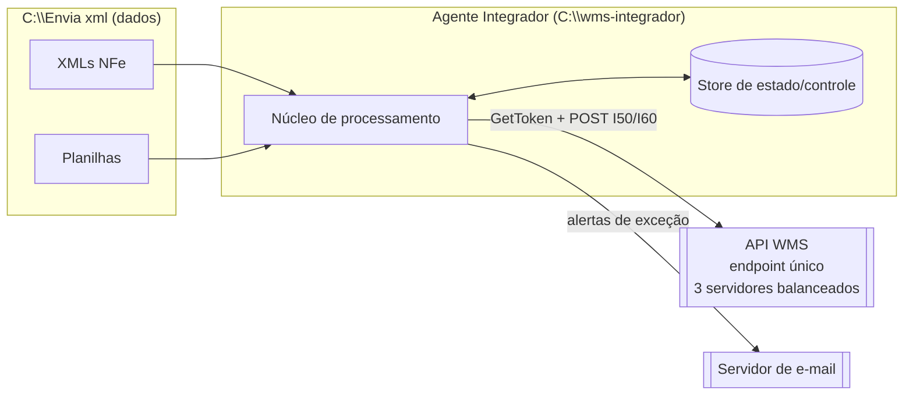
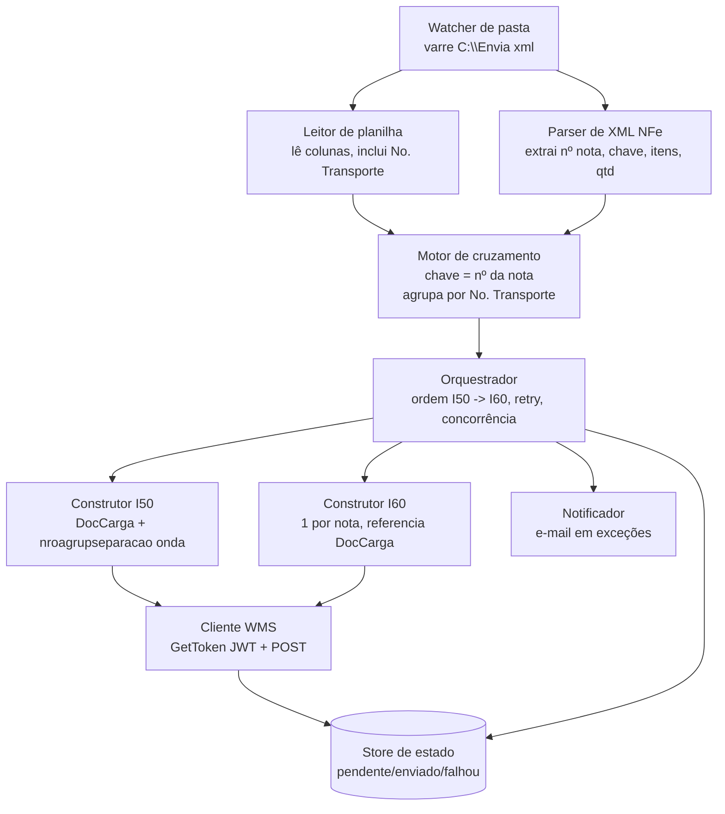
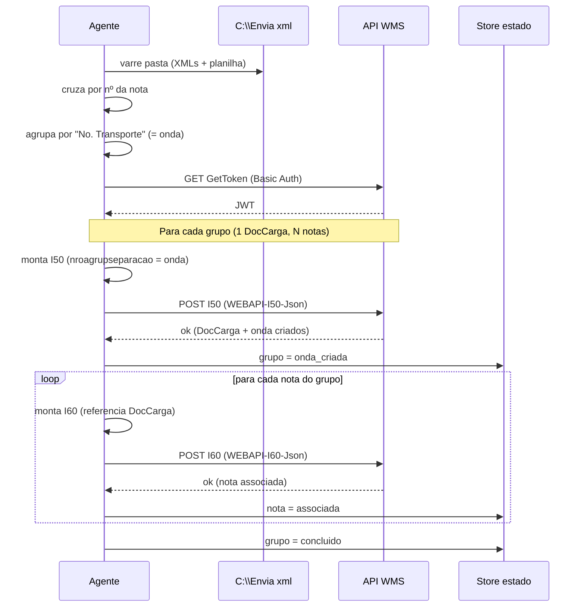
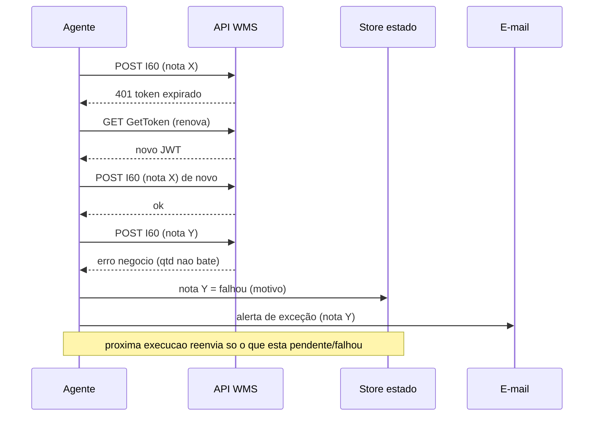
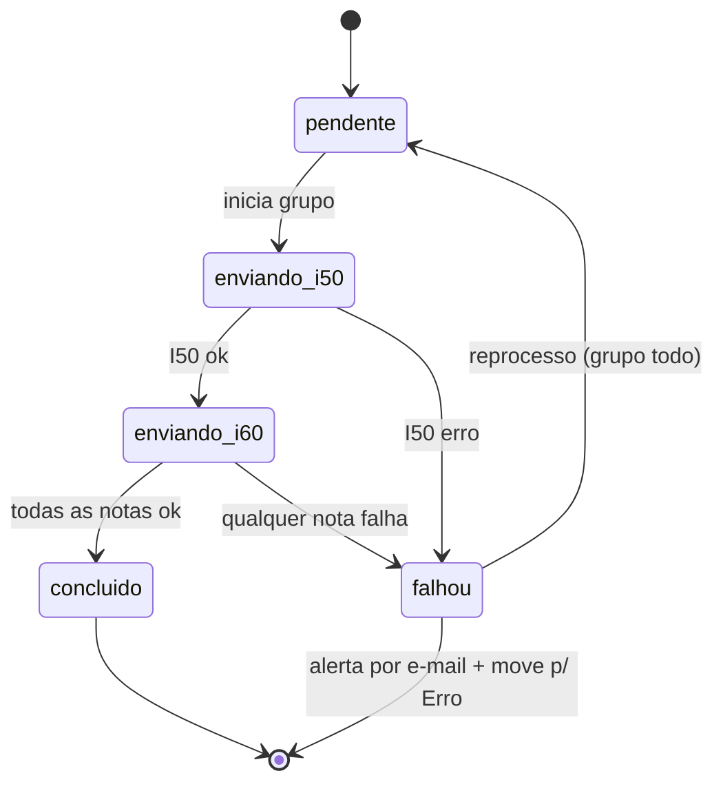

# Arquitetura — Integrador WMS (SolWMS Assist)

Desenho de fluxo de comunicação. **Sem código de produção** — base para revisão e
iteração. Ver `BRIEFING.md` para as regras de negócio.

---

## 1. Contexto

Quem conversa com quem. O agente mora em `C:\wms-integrador`, lê dados de
`C:\Envia xml`, fala com a API do WMS (endpoint único balanceado) e envia alertas.



---

## 2. Componentes

Peças internas do agente e suas responsabilidades.



---

## 3. Sequência — fluxo feliz

Token → I50 (cria DocCarga + onda) → I60 por nota (associa). Um DocCarga pode ter N
notas (agrupadas por "No. Transporte").



---

## 4. Sequência — token, erro e reenvio

Expiração de token, falha numa nota e reprocesso só do que faltou (idempotência).



---

## 5. Máquina de estados

Estado do **grupo/DocCarga**. Regra: **falha é no grupo inteiro** — se o I50 ou
qualquer nota (I60) do grupo falha, o grupo todo vai para `falhou`. Não há estado
parcial; o grupo só é `concluido` quando o I50 e **todas** as I60 passaram.



### Idempotência (WMS é a fonte de verdade)

O WMS **bloqueia duplicados**: rejeita um I50 que já existe e também bloqueia se a
**onda já saiu do estado "editando"**. O store local apenas registra o progresso; a
trava real é do WMS. Consequência no reprocesso de um grupo falho:

- Ao reenviar o grupo, o I50 pode voltar **"já existe"** (porque passou antes). Isso
  **não é erro** — é tratado como "DocCarga já criado, seguir para as I60".
- Se a **onda já saiu de editando**, o WMS bloqueia alterações. Esse caso vira
  **exceção definitiva** (não adianta retry) → alerta por e-mail + pasta `Erro`.

---

## 6. Faseamento sugerido

1. **Fase 1 — transporte + controle**: cliente WMS (token + POST), I50 a partir do
   cruzamento, I60 referenciando DocCarga, store de estado e reenvio. Mede o gargalo
   real no homolog.
2. **Fase 2 — alertas**: notificador por e-mail nas exceções definidas.
3. **Fase 3 — automação total**: watcher contínuo da pasta, concorrência ajustada.

---

## 7. Decisões em aberto (a fechar no desenho)

- **Concorrência**: quantas requisições simultâneas ao endpoint? (começar baixo e medir)
- **Store de estado**: arquivo JSON por lote, SQLite, ou outro?
- **Idempotência**: como garantir que reenvio não duplica DocCarga/nota? (chave de
  controle local + consulta ao WMS?)
- **Retry**: nº de tentativas, backoff, o que é erro transitório vs. definitivo.
- **Amarração I50↔I60**: confirmar `numeroPedido` ↔ `pedidos[]`.
- **Exceções que geram e-mail**: lista a definir.
- **Movimentação de arquivos**: após processar, mover XML/planilha para
  `processados/` ou `erro/`? (evita reprocesso e organiza auditoria)
```

