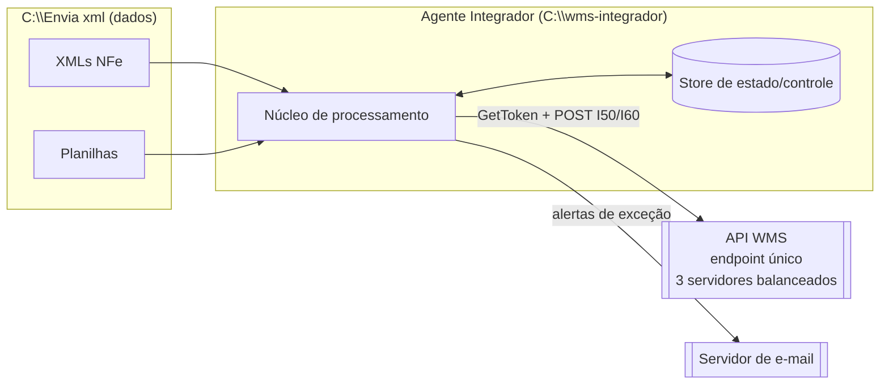
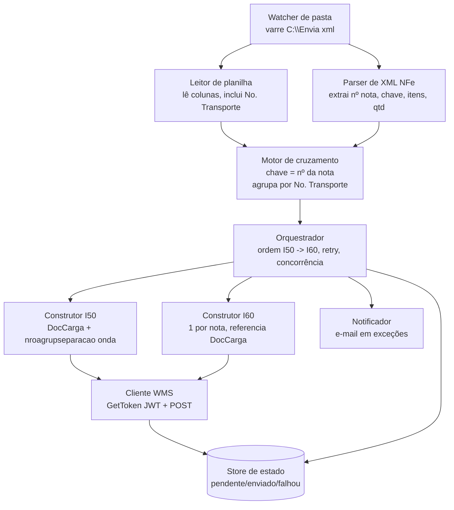
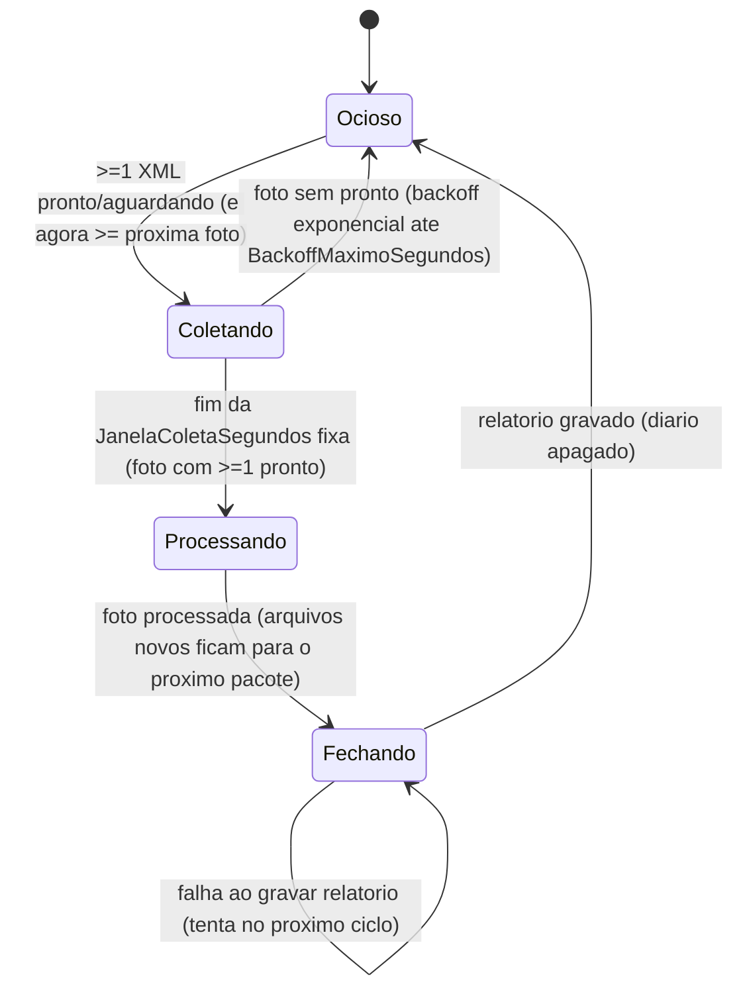
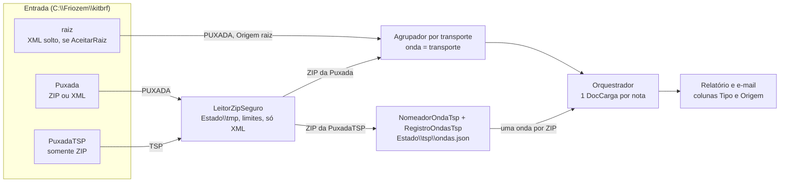
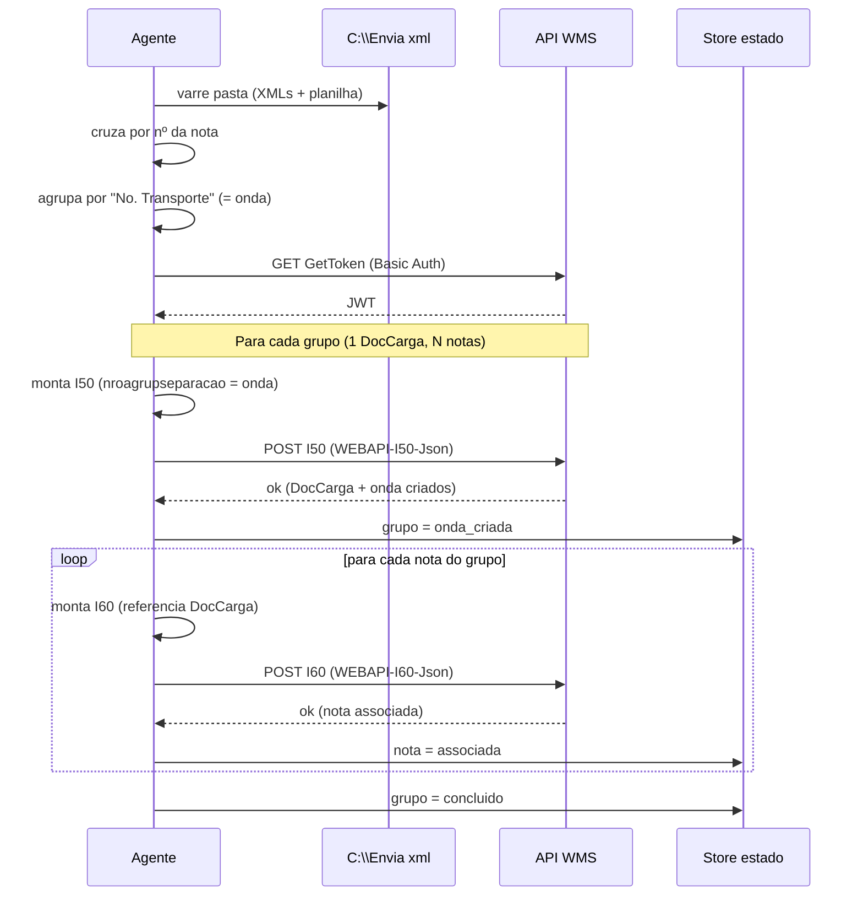
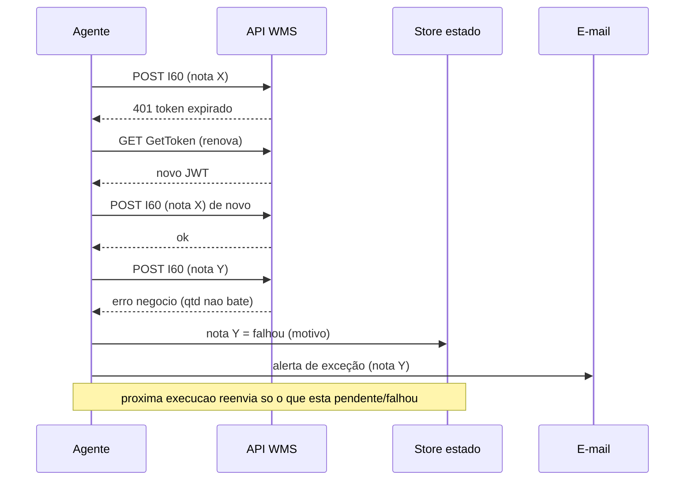
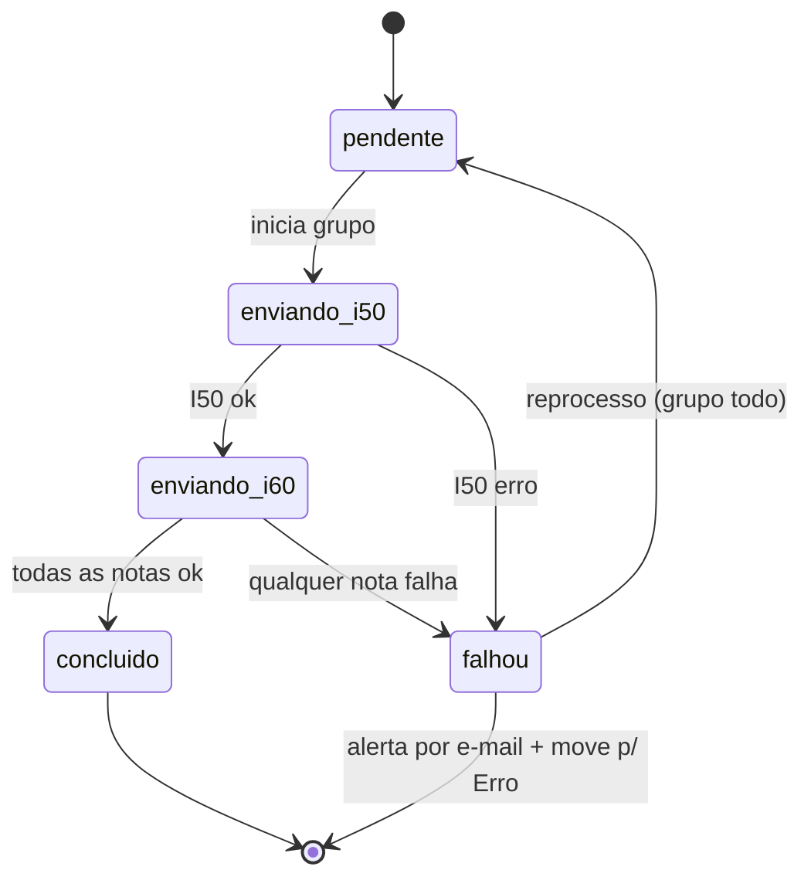

# Arquitetura — Integrador WMS (SolWMS Assist)

Desenho de fluxo de comunicação. **Sem código de produção** — base para revisão e
iteração. Ver `BRIEFING.md` para as regras de negócio.

> **Estado atual (09/11/2026):** este documento descreve o desenho original (I50 → I60). Em
> produção a **I60 está desativada por flag** (`I60:Habilitada=false`); o código da I60 foi mantido
> e pode ser reativado com `I60__Habilitada=true`. Os trechos abaixo que citam a I60 valem apenas
> se a flag for ligada. Ver `ENCERRAMENTO.md` e `OPERACAO.md`.
>
> **Atualização (09/11/2026, Plano A):** a I60 está **em preparação para reativação** via código
> customizado do WMS (`docs/wms-codigo-customizado`): o PL/SQL grava `QTD_VOLUMES` do DocCarga como
> a soma de `qtd_informada_cxs` dos itens, e a I60 envia `qtdeVolume` com a mesma regra (soma das
> caixas dos itens, não mais `transp/vol/qVol`). Em produção continua desligada; o teste é em
> homolog (`docs/wms-codigo-customizado/ROTEIRO-TESTE-HOMOLOG.md`). O tipo de operação da I60 é
> configurável (`I60:TipoOperacaoNota`, padrão `INE`). A retenção de `Processados`/`Erro` passou
> para 60 dias. O Plano B (devolução pela I40) está arquitetado em `ARQUITETURA-PLANO-B-I40.md`
> (não implementado).
>
> **Atualização (12/11/2026, Puxada TSP):** a entrada tem as subpastas `Puxada` e `PuxadaTSP` (e a raiz,
> aceita como puxada), os ZIPs são lidos com segurança e a TSP sobe com uma onda por ZIP. Ver §2.2.

---

## 1. Contexto

Quem conversa com quem. O agente mora em `C:\wms-integrador`, lê dados de
`C:\Envia xml`, fala com a API do WMS (endpoint único balanceado) e envia alertas.



---

## 2. Componentes

Peças internas do agente e suas responsabilidades.



### 2.1 Etapa 7 — watcher, pacote, movimentação, limpeza e e-mail

Toda a lógica testável fica no Core (`Core/Pacote`, `Core/Email`); o `Worker` é fino
(`BackgroundService` + DI). Componentes:

| Componente | Responsabilidade |
|---|---|
| `Worker` | Loop contínuo: limpeza na partida e a cada 24 h; `GerenciadorPacote.CicloAsync` a cada `Pacote:IntervaloVarreduraSegundos`. Exceção de ciclo só é logada. |
| `DetectorArquivoPronto` | Polling (não `FileSystemWatcher`, que perde eventos em pasta de rede). Arquivo pronto = mesmo tamanho/data em 2 ciclos, estável há `EstabilizacaoSegundos` (relógio `IClock`) e abertura com `FileShare.None`. Acima de `TimeoutArquivoSegundos` vira "instável" e não bloqueia o fechamento. |
| `GerenciadorPacote` | Máquina de estados do pacote (abaixo): janela de coleta fixa, foto da pasta, backoff e retomada com reconciliação. |
| `ProcessadorLote` | Abre os ZIPs (`LeitorZipSeguro`); parse → `AgrupadorTransporte` (PUXADA) ou uma onda por ZIP (TSP, §2.2) → ondas (transportes) com `SemaphoreSlim(MaxTransportesConcorrentes)`; dentro da onda, uma nota por vez no `IOrquestrador`; classifica o destino, move logo após cada nota e registra no diário. |
| `ClassificadorCategoriaErro` / `OrganizadorArquivos` | Destino (`Processados`/`Erro\<Categoria>`) e movimentação com sidecar `.motivo.txt`. |
| `DiarioPacote` | JSONL `Estado\pacote-atual.jsonl` (append + flush) para retomar o pacote após queda. |
| `FechadorPacote` | Relatório HTML+PDF `pacote_<yyyyMMdd_HHmmss>` em `Relatorio:PastaSaida` (sempre) e e-mail conforme `PoliticaEnvioEmail`. |
| `LimpadorPastas` | Remove arquivos com mais de `Limpeza:DiasRetencao` dias de `Processados` e `Erro`. |

Máquina de estados do pacote:



Foto do pacote: ao fim da janela fixa, o conjunto de XMLs prontos é congelado (com a primeira/última gravação, `PeriodoColeta`) e processado por transporte, em sequência; ao terminar, o mesmo ciclo fecha o pacote (relatório + 1 e-mail). Arquivos que chegam durante o processamento formam o próximo pacote. A quietude foi removida (o fechamento é determinístico). Arquivo que não estabiliza nunca abre pacote sozinho: foto vazia volta a Ocioso com backoff.

`ConsolidadorRegistros` mantém um registro por arquivo (primeiro integrado; senão o primeiro). Na retomada, arquivo com registro no diário ainda na entrada é só movido (`ProcessadorLote.ReconciliarMove`, sem WMS); se foi regravado depois do registro, o registro antigo é descartado e o arquivo é reprocessado como novo; `RepetirMovesPendentes` repete moves falhos a cada ciclo Ocioso.
 e idempotência: cada resultado é gravado no diário **antes** de mover o arquivo e
o arquivo é movido logo após cada nota, então uma queda reenvia no máximo a nota em voo; o
WMS barra a duplicata ("já existe", §5) e o processador a trata como processada. No
reinício, o pacote é reaberto com as linhas do diário e o relatório final contém também o
que foi enviado antes da queda. Se o move falhar após o envio, o arquivo entra num conjunto
em memória "enviado, mover pendente": o move é repetido, nunca o envio.

---

### 2.2 Puxada e Puxada TSP (12/11/2026): pastas, ZIP e onda

A entrada passou a ter duas subpastas de depósito. O **tipo** da nota vem da pasta, sem detecção
automática: `Puxada` e raiz = `PUXADA`; `PuxadaTSP` = `TSP`. Escopo e decisões em
[`ESCOPO-PUXADA-TSP.md`](ESCOPO-PUXADA-TSP.md).



Regras de implementação:

- **Pastas:** `ClassificadorEntrada.ClassificarPastas` lista (só o topo) `Puxada`, `PuxadaTSP` e a
  raiz (se `Pastas:AceitarRaiz`). `Processados`, `Erro` e `Estado` não são entrada. A `PuxadaTSP`
  aceita só ZIP; qualquer outro arquivo definitivo cai como `ExtensaoInvalida`.
- **ZIP:** `LeitorZipSeguro` (`System.IO.Compression`, sem NuGet novo) extrai para `Estado\tmp\<id>`,
  achata nomes, ignora caminho perigoso (`..`, absoluto), aceita só `.xml`, não abre ZIP aninhado e
  respeita `Zip:MaxArquivos` e `Zip:MaxTamanhoMb` (tamanho declarado e bytes realmente copiados). ZIP
  ilegível, com senha, vazio de XML ou acima dos limites vira `CategoriaErro.ZipInvalido`
  (`Erro\<pacote>\ZipInvalido` + `.motivo.txt`). Os XMLs e o ZIP original vão para
  `Processados\pacote_*\` (o layout continua servindo à busca por `NFE<chave>.XML`).
- **Repetidos:** a mesma chave de NF-e processada uma vez por pacote; a repetida é registrada como
  `ArquivoIgnorado` ("XML repetido").
- **Onda da TSP:** `TSP-AAAAMMDD-NN-NOME` (prefixo fixo, data do servidor, sequencial do dia, nome do ZIP
  limpo). Parte fixa de 16 caracteres, NOME cortado em 14, total máximo 30 (limite de
  `nroagrupseparacao` na I50). Sem nome: `TSP-AAAAMMDD-NN`. `RegistroOndasTsp` grava em
  `Estado\tsp\ondas.json` (gravação atômica) o último sequencial do dia e o hash SHA-256 de cada ZIP, de
  modo que reenviar o mesmo ZIP reaproveita a mesma onda.
- **Agrupamento:** PUXADA continua por `AgrupadorTransporte` (onda = transporte). TSP cria uma onda por
  ZIP: todas as notas do ZIP seguem para o `IOrquestrador` com o mesmo `nroagrupseparacao`; o DocCarga
  continua sendo um por nota. Nota de TSP sem transporte no `infCpl` sobe normalmente.
- **Relatório:** cada linha do diário (`RegistroDiario`) e do relatório (`LinhaRelatorioErro`) carrega
  `Tipo`, `Origem`, `Onda` e `Zip`. O HTML/PDF ganha as colunas Tipo e Origem; a TSP é agrupada por onda
  (com notas e transportes distintos) e a PUXADA por transporte. O e-mail e a telemetria contam notas
  por tipo e da raiz (campos novos no fim dos registros, com valor padrão, então diário e telemetria
  antigos continuam legíveis).
- **Tempo de integração (12/11/2026):** medido com o `IClock` em quatro pontos. `Orquestrador` soma a
  duração das chamadas ao WMS de cada nota (`ResultadoIntegracaoNota.DuracaoWmsMs`); `ProcessadorLote`
  mede a leitura (`UltimaLeituraMs`) e grava no diário o início e a duração de WMS de cada nota
  (`RegistroDiario.InicioNota`, `DuracaoWmsMs`, campos novos no fim, com padrão); `GerenciadorPacote`
  mede a espera da janela (abertura até a foto) e passa `EtapasPacote` ao `FechadorPacote`, que monta
  `MedicaoTempo` (fase de integração, soma do WMS e tempo por onda TSP saem do diário, então sobrevivem
  a uma queda) e entrega `DadosPacote` (id + medição) ao `IGeradorRelatorio` e ao `CorpoEmailResumo`.
  HTML, PDF e e-mail diagramam o mesmo `BlocoTempo`. A geração do relatório é medida com `Stopwatch`
  no `FechadorPacote` e vai só para a telemetria (`TempoRelatorioMs`), pois não cabe dentro dele.
  Telemetria: `EsperaJanelaMs`, `LeituraMs`, `IntegracaoWmsMs`, `ChamadasWmsMs`, `TempoRelatorioMs`,
  `Ondas` (opcionais; linhas antigas leem 0/nulo). Cabeçalho do relatório: logo negativa embutida no
  Core (`IdentidadeVisual.ObterLogo`: `LogoPath` -> embutida -> texto) e título "Relatório de Integração".
- **Premissa a validar no homolog:** na TSP o `numeroPlanejamento` da I50 repete o nome da onda (como na
  puxada repete o transporte), pois o `Orquestrador` usa o mesmo argumento para os dois campos.

---

## 3. Sequência — fluxo feliz

Token → I50 (cria DocCarga + onda) → I60 por nota (associa). Um DocCarga pode ter N
notas (agrupadas por "No. Transporte").



---

## 4. Sequência — token, erro e reenvio

Expiração de token, falha numa nota e reprocesso só do que faltou (idempotência).



---

## 5. Máquina de estados

Estado do **grupo/DocCarga**. Regra: **falha é no grupo inteiro** — se o I50 ou
qualquer nota (I60) do grupo falha, o grupo todo vai para `falhou`. Não há estado
parcial; o grupo só é `concluido` quando o I50 e **todas** as I60 passaram.



### Idempotência (WMS é a fonte de verdade)

O WMS **bloqueia duplicados**: rejeita um I50 que já existe e também bloqueia se a
**onda já saiu do estado "editando"**. O store local apenas registra o progresso; a
trava real é do WMS. Consequência no reprocesso de um grupo falho:

- Ao reenviar o grupo, o I50 pode voltar **"já existe"** (porque passou antes). Isso
  **não é erro** — é tratado como "DocCarga já criado, seguir para as I60".
- Se a **onda já saiu de editando**, o WMS bloqueia alterações. Esse caso vira
  **exceção definitiva** (não adianta retry) → alerta por e-mail + pasta `Erro`.

---

## 6. Faseamento sugerido

1. **Fase 1 — transporte + controle**: cliente WMS (token + POST), I50 a partir do
   cruzamento, I60 referenciando DocCarga, store de estado e reenvio. Mede o gargalo
   real no homolog.
2. **Fase 2 — alertas**: notificador por e-mail nas exceções definidas.
3. **Fase 3 — automação total**: watcher contínuo da pasta, concorrência ajustada.
   *Implementada na Etapa 7* (ver §2.1 e `docs/OPERACAO.md`): watcher por polling,
   pacote com início/fim, movimentação, limpeza de 60 dias (era 10; ampliada em 09/11 para o Plano B) e e-mail com PDF.

---

## 7. Decisões em aberto (a fechar no desenho)

- **Concorrência**: quantas requisições simultâneas ao endpoint? (começar baixo e medir)
- **Store de estado**: arquivo JSON por lote, SQLite, ou outro?
- **Idempotência**: como garantir que reenvio não duplica DocCarga/nota? (chave de
  controle local + consulta ao WMS?)
- **Retry**: nº de tentativas, backoff, o que é erro transitório vs. definitivo.
- **Amarração I50↔I60**: confirmar `numeroPedido` ↔ `pedidos[]`.
- **Exceções que geram e-mail**: lista a definir.
- ~~**Movimentação de arquivos**~~ — **fechada na Etapa 7**: `Processados` e
  `Erro\<Categoria>` (configurável: `Pastas:OrganizacaoErro`), com sidecar `.motivo.txt`.
- ~~**Concorrência**~~ — **fechada (padrão conservador)**: ondas por transporte em paralelo
  limitado por `Pacote:MaxTransportesConcorrentes` (padrão 1; 2 é seguro).

Pontos ainda **em aberto** após a Etapa 7:

- **Texto real da duplicata na I50**: assume-se que contém "já existe" (não verificado no WMS).
- **Nota tardia de transporte já enviado** no mesmo pacote: vai em lote posterior com o mesmo
  `nroagrupseparacao`; o WMS pode bloquear se a onda saiu de "editando" (cairia como
  não integrada com a mensagem do WMS).
- **SMTP**: `SmtpClient` não suporta TLS implícito (465) nem OAuth2; se o provedor exigir,
  avaliar MailKit atrás de `IEnviadorEmail`.
- **Padrões** de janela de coleta (10 s), backoff máximo (120 s) e timeout de arquivo (300 s)
  são estimativas a validar em operação.
```

